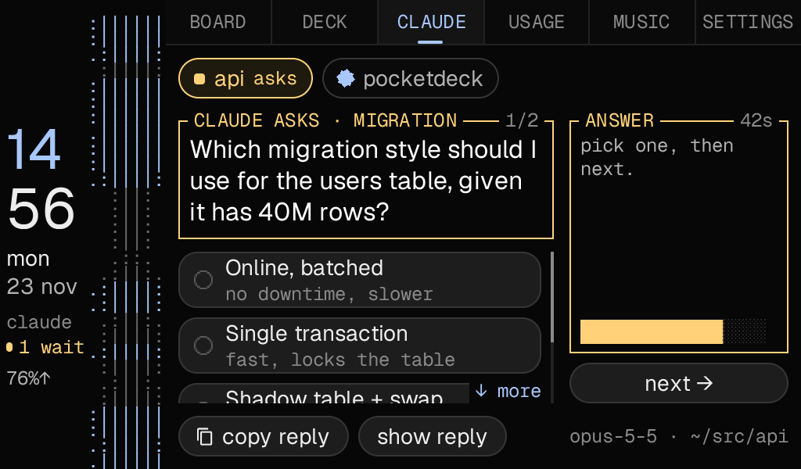
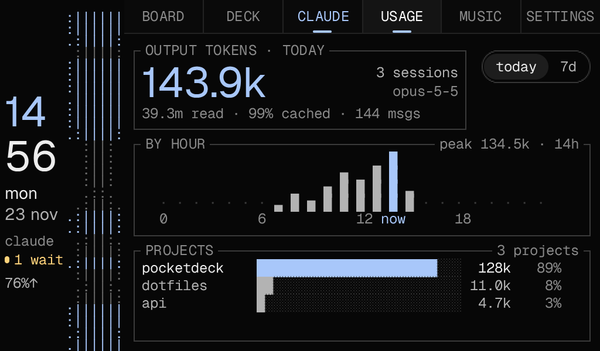
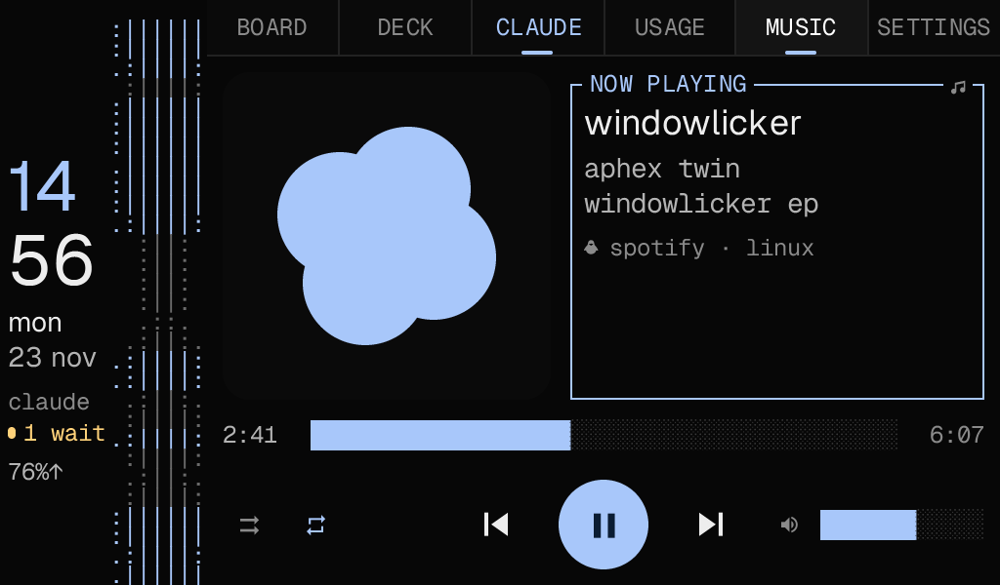
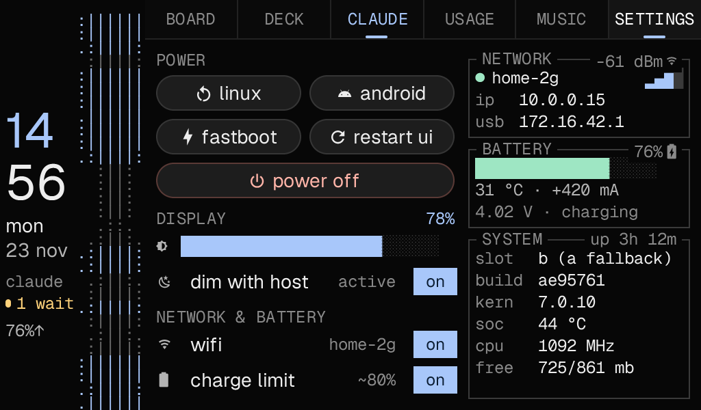
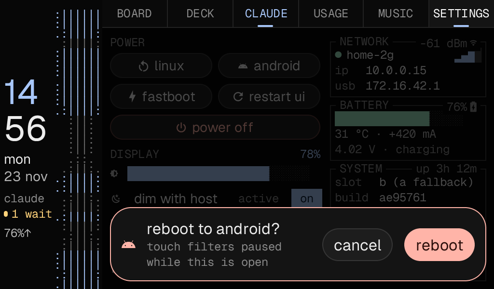

# PocketDeck

**A 2017 Lenovo Tab 7 (TB-7304X, MT6737M) turned into a 60 fps desk display**: Claude Code sessions, a stream-deck
grid, now playing, host and tablet vitals, Claude usage and the tablet's own settings. It runs mainline Linux, and
saving a UI file on the host hot-reloads the tablet in about 2 seconds.

The panel is cracked, with dead pixels on the left fifth: that strip is the **rail** (clock, date, Claude status,
battery and an ASCII sound wave) and every page lives in the clean area to its right. Read-only content is drawn
as terminal frames, everything you tap is rounded; icons are single-colour Nerd Font glyphs.

| | |
|---|---|
|  |  |
| **BOARD**: host and tablet vitals, 1m / 10m / 1h history | **DECK**: tappable actions that run on the host |
|  |  |
| **CLAUDE**: live sessions, reply, current step, context | **CLAUDE**: answer questions, approve plans and permissions from the tablet |
|  |  |
| **USAGE**: today's tokens by hour and project, or the last 7 days | **MUSIC**: cover art, tap-to-seek bar, shuffle, repeat, volume |
|  |  |
| **SETTINGS**: reboot targets, brightness, WiFi, charge limit, system info | confirmations pause the cracked glass's ghost-touch filters |

Screenshots come from the PocketJS web renderer with mock data (`pocketjs/apps/desk/preview`); panes and tiles
are configured in **Deck Studio**, a small web app deckd serves on localhost.

## From a stock tablet

| Stage | | Command | Doc |
|---|---|---|---|
| 0 | Host ready | `./pd doctor` | [prerequisites](docs/install/00-prerequisites.md) |
| 1 | Back up, unlock, root | mtkclient, Magisk | [backup-unlock-root](docs/install/01-backup-unlock-root.md) |
| 2 | Repartition | `tools/tb-gpt.py` | [repartition](docs/install/02-repartition.md) |
| 3 | U-Boot in `boot`, Android in `recovery` | `./pd flash uboot` | [uboot](docs/install/03-uboot.md) |
| 4 | Linux on the eMMC | `./pd build all`, `./pd install kernel rootfs` | [linux](docs/install/04-linux.md) |
| 5 | PocketDeck | `./pd deploy`, `./pd deckd` | [pocketdeck](docs/install/05-pocketdeck.md) |
| – | Something broke | `./pd state`, `./pd slot a`, `./pd reboot android` | [recovery](docs/install/recovery.md) |

> Stages 1–3 write the tablet's flash; read [recovery.md](docs/install/recovery.md) first. Your partition dump
> contains device-unique data (IMEI/NVRAM): **never commit or publish `backup/`.**

## How it fits together

```
 Host (Linux or macOS)                                 Tablet (Linux 7.0, Alpine)
┌──────────────────────────────────────┐   USB     ┌───────────────────────────────────────┐
│ deckd  (Bun)                         │  network  │ pocketdeck-ui: PocketJS Linux host    │
│  ├ providers: clock, CPU/RAM, music, │  ssh -R   │  (Rust/musl, DRM/KMS, 1024×600 @60)   │
│  │  Claude sessions, usage, tablet   │◀────────▶ │  ├ link: TCP client, JSON lines       │
│  ├ actions: shell, app, URL, …       │ tcp:7777  │  └ QuickJS runs the deck app (TSX)    │
│  ├ watches the app → rebuild + push  │           └───────────────────────────────────────┘
│  └ :7778  Claude hooks + Deck Studio │            LK → U-Boot → Linux (slots A/B), Android in recovery
└──────────────────────────────────────┘
      ▲ HTTP POST from Claude Code hooks
```

| Path | What |
|---|---|
| [`pd`](pd) | the command line: build, install, deploy, state, reboot, recovery helpers |
| [`device/`](docs/dev/workflow.md#where-things-are) | everything flashed to the tablet: DTS, kernel patches, WiFi driver, U-Boot, initramfs, rootfs, Mesa |
| [`deckd/`](deckd/README.md) | the host daemon, Deck Studio, Claude Code hooks |
| [`pocketjs/`](https://github.com/g8row/pocketjs/tree/android-host) | submodule: the UI framework, the host (`hosts/android` also builds the Linux binary), the deck app (`apps/desk`) |
| [`tools/`](tools) | host scripts behind `pd` |
| [`docs/`](docs/index.md) | install path, architecture, hardware status and research, dev notes |
| [`archive/android/`](archive/android/README.md) | the Android era (its debloat module is still needed for the rollback Android) |

## Status

Works on the device: display (mediatek-drm, 60 Hz), touch, buttons, 4 cores with cpufreq, GPU (Panfrost), eMMC,
USB networking, WiFi, charger/battery/RTC/thermal, accelerometer; the boot chain with slots, boot counter, boot menu
and Android rollback; the redesigned UI (six pages, rail, hot reload, deck actions, Claude hooks), tablet settings
run locally on the tablet (reboot targets, brightness, WiFi, charge limit), Deck Studio.

Open: Bluetooth (powers on, scans find nothing), hardware display planes, GPU frequency scaling; approving
permission prompts from the tablet is built but experimental; the macOS side of deckd's new data (Music.app
controls, lock detection) is written but untested. Audio, camera and modem are not planned.
Details: [docs/hardware/status.md](docs/hardware/status.md).

## Credits

- [PocketJS](https://github.com/zerob13/pocketjs) by Yifeng "Evan" Wang (MIT), extended in the fork.
- The [mt6735-mainline](https://gitlab.com/mt6735-mainline/linux) kernel and U-Boot trees, and postmarketOS.
- [mtkclient](https://github.com/bkerler/mtkclient) and [Magisk](https://github.com/topjohnwu/Magisk).
- [Geist](https://vercel.com/font) fonts (OFL).

Built in pair work with Claude Code. Licensed [MIT](LICENSE). History before the rename: tag `android-era-final`.
